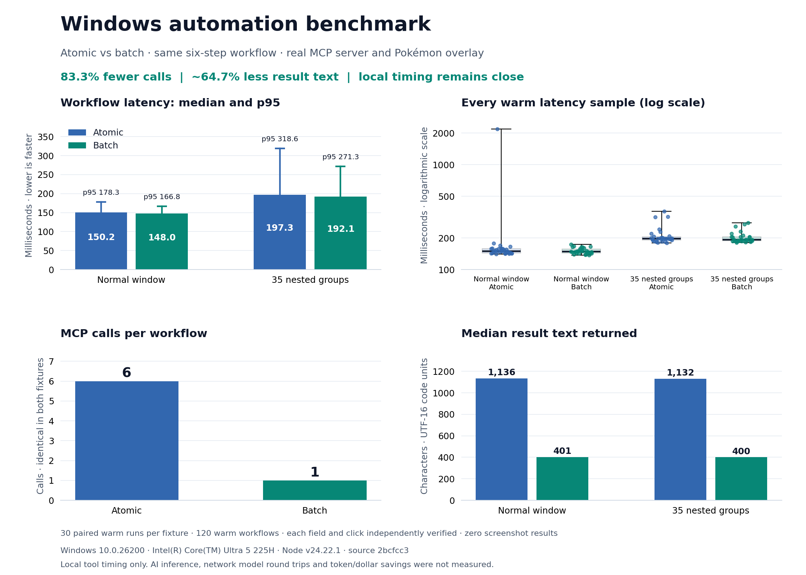

# Pokémon Computer Companion

An AI controls your computer through MCP while an animated Pokémon appears to do the work on your desktop. Claude, Codex, or another MCP client is the brain. The local computer-use backend performs the actions, and the Electron companion shows movement, typing, thinking, speech, and celebrations.

All seven Pokémon from the pet repository are included: **Pikachu, Riolu, Lucario, Clodsire, Bulbasaur, Charmander, and Squirtle**, alongside **Hello Kitty and Kuromi** in matching pixel-art style. Pikachu is the default. Change among all nine companions from the team panel, the tray menu, or the `pokemon` tool (`hello-kitty` and `kuromi`).

## Easy installation

For **Claude Desktop on Windows or macOS**, download the matching **`.mcpb` extension** from [Releases](https://github.com/Minsun1503/pokemon-companion/releases/latest), open it in Claude, confirm **Install**, and enable Pokémon Companion. Claude launches the companion and uses its tools from your chat. Node, Electron, native desktop helpers, and all seven Pokémon are included. No terminal commands, additional software, GitHub login, model API key, or manual MCP settings are required. macOS still requires its normal Accessibility and Screen Recording permissions. See [installation steps](INSTALL.md).

The **ChatGPT desktop plugin ZIPs** contain the complete local MCP server and its runtimes, with native plugin manifests. Public installation from ChatGPT's Plugins directory requires **OpenAI local-MCP partner approval and plugin review**. That approval has not been obtained; these files are prepared for submission, and opening a ZIP in ChatGPT does not install them. See [OpenAI's desktop-only distribution requirements](https://developers.openai.com/plugins/deploy/desktop-only).

Windows, macOS Intel, macOS Apple Silicon, and Linux x64 have separate plugin downloads. Claude's official desktop extension loader supports Windows/macOS. The Linux package is for hosts supporting local desktop plugins and requires an Ubuntu 24.04-compatible X11 desktop with user namespaces. macOS/Linux desktop workflows remain experimental. The macOS binaries are ad-hoc signed and not notarized.

Existing Windows Claude Code and Codex installers remain available in the compatibility ZIP. They require the selected AI client to already be installed. Developers build the native client packages with `npm run package:desktop`; see [INSTALL.md](INSTALL.md).

## Original repositories

This project includes the modified source of **[Pokemon-pets](https://github.com/DEV-asdf-516/Pokemon-pets)** in `frontend/` and **[computer-use-mcp](https://github.com/domdomegg/computer-use-mcp)** in `backend/`. Both original MIT licenses are retained. See [upstream authors and exact base commits](THIRD_PARTY.md).

## Run locally

Requires Node.js **22.12 or newer**, npm, and an unlocked graphical desktop. Run the commands below from the `pokemon-companion` folder, which contains the `frontend` and `backend` repositories, shared scripts, and MCP configuration.

```powershell
npm run setup
npm run build
npm run demo
```

The demo opens the companion and shows working, thinking, and completion animations without sending computer input. Left-click the pet to open its action menu. Ctrl+C in the demo terminal closes the demo and companion.

## Connect Claude or Codex

```powershell
npm run config
```

This generates configuration using the actual Node executable and checkout paths:

- `config/claude-desktop.json`: merge its `mcpServers` entry into your Claude Desktop MCP configuration, then restart Claude Desktop.
- `config/codex.toml`: add its server table to your Codex `config.toml`, then reconnect the MCP server. See [official Codex MCP configuration](https://developers.openai.com/codex/mcp/).

Use a local MCP client on the same computer as the companion. A cloud-only client cannot manipulate this desktop without a local connection. Computer control uses the connected AI client's model. Talk is deferred and disabled in the companion.

Try: **“Use Pikachu to help me with my computer. Announce the task, inspect the screen, perform the actions, and tell me when you’ve verified the result.”**

## Tools

`desktop` with `{"action":"status"}` checks backend readiness, supported native actions, platform limits, and pause state. It sends no input, works while paused, and is bounded to five seconds including queue time. Readiness does not establish permission to control every app.

On Windows, **`windows` is the preferred tool**. It uses Win32 to list/activate windows and Windows UI Automation to read named controls and invoke their supported actions. Its results are compact text, with no screenshot images. The worker starts once and is reused for later requests. Discovery values come from each fresh per-node cache; actions still revalidate targets and verify field changes with live reads.

Discovery results report `complete` and `truncated`. Windows errors include `error_details` with an error code and delivery/retry evidence; retry a failed operation only when its evidence permits it. In a partial batch, this applies only to the stopped step, and earlier steps remain applied. See the [Windows discovery and error contract](docs/windows-api.md).

See the [agent-desktop comparison and improvement roadmap](docs/agent-desktop-comparison.md) for the architecture review and implemented reliability changes.

Use `get_windows` to choose a `window_id`, then `get_ui` to inspect that window. Narrow `query` or `control_type` (such as `Button`, `Edit`, or `TabItem`) to return only relevant controls. Results default to 60 elements and 6,000 characters; lower `max_elements`/`max_chars` when possible. `truncated` indicates that you should narrow the query or increase the budget. For actions, pass the returned `snapshot` and `element_id`:

Preserve discovery's `window_ref` with `window_id` on later reads and activation. Batch window references propagate it automatically. `get_ui` with `view:"skeleton"` lists named containers without field-value previews. Select a targetable container and supply its `root_snapshot` and `root_element_id` to read its subtree. Partial or ambiguous root identities cannot be used for actions.

`max_chars` must be at most 16,000. Field previews are limited to 160 characters and carry `value_clipped: true` when shortened, even if the tree has `truncated: false`; use `read_text` for the full field text. If only title-bar controls appear, call `activate` on the window and read again: Electron/Chromium may expose their controls only after activation. After navigation or `invoke`, the first read may still show the previous view; re-read once before concluding.

`matched` is a lower bound when `truncated` is true. Use `wait_for` to poll controls or exact values with a bounded timeout (default 5 seconds, maximum 15 seconds). After an interrupted wait, call `get_ui` again for fresh snapshots. Use `launch` to start an executable name/path or HTTP(S) URL and wait for a window; URLs require a window-title/process `query`, and command shells, script hosts and arguments are unsupported. Interrupted Windows ASCII typing reports submitted characters; input methods may transform them, so inspect the field before continuing instead of retyping from the start.

`wait_condition` supports `present`, `absent`, `enabled`, `disabled`, `selected`, and `unselected`. An absence wait requires `snapshot` and `element_id` from an earlier complete whole-window observation of a unique control; its query must equal the captured stable name or automation ID. It succeeds only after complete zero-match coverage within the same observed window. See the [Windows contract](docs/windows-api.md) for examples and limits.

```json
{"action":"get_ui","window_id":"12345","query":"Search","control_type":"Edit","max_chars":2000}
{"action":"set_value","snapshot":"<returned snapshot>","element_id":1,"text":"Daft Punk"}
```

Supported control actions include `invoke`, `set_value`, `select`, `toggle`, `expand`, `collapse`, `scroll`, `focus`, and `read_text`. Only use actions listed for the returned control. Re-read `get_ui` after changes to verify the result. IDs belong to their snapshot, expire after two minutes, and are never rebound to a different control. Password controls are omitted.

**Batch is the default Windows mode.** Supply `steps` and omit the top-level `action`, or set `action:"batch"` explicitly. The MCP runs 1-16 steps sequentially and returns just the final result and completed count. Use an explicit atomic action when the next step needs judgment. For example, finding a window, filling a field, pressing a button, and checking the field takes one MCP call:

```json
{
  "max_chars": 2000,
  "steps": [
    {"action":"get_windows","query":"Pokémon Input Test"},
    {"action":"get_ui","window_step":0,"query":"Test note","control_type":"Edit"},
    {"action":"set_value","target_step":1,"text":"Hello from Pikachu!"},
    {"action":"get_ui","window_step":0,"query":"Verify input","control_type":"Button"},
    {"action":"invoke","target_step":3},
    {"action":"get_ui","window_step":0,"query":"Test note","control_type":"Edit","expect_value":"Hello from Pikachu!"}
  ]
}
```

`window_step` and `target_step` are zero-based references to earlier results in the same batch. A window reference accepts a unique, untruncated `get_windows` result or the window from `get_ui`. A control reference requires exactly one untruncated `get_ui` match supporting the action. Explicit `window_id` or `snapshot`/`element_id` can also be used instead of references. `expect_value` on `get_ui` checks one control's exact value (up to 160 characters) before continuing. It verifies the field, not any later application side effect.

The whole sequence excludes input from other MCP clients, checks user pauses and cancellation before each step, and stops on an error or ambiguous target. Failure output reports `completed`, `stopped_step`, `failed_step_started`, and bounded diagnostics. Earlier successful steps remain applied; a failed native step may also have applied its action. Inputs are never retried automatically. Inspect the failure before continuing. Top-level `max_chars` bounds the entire response, while each step has its own discovery budget; narrow filters if results are truncated. Use atomic calls when the next step requires the AI to interpret new information. Batching reduces model round trips; Windows API calls still execute individually on the computer.

`computer` retains native mouse/keyboard input, cursor actions, and screenshot capture. Prefer keyboard shortcuts when UI Automation lacks a pattern, and screenshots when the task requires visual information (for example, canvas content). The tool descriptions and `pokemon-work` prompt specify this order: **Windows APIs → keyboard shortcuts → screenshots**. Both tools update the Pokémon before and after actions. Screenshots briefly hide the companion.

Handled failures from `computer`, Course, and Excel include `contract_version:1` and delivery/retry evidence. Generic input success reports `verified:false`: it confirms dispatch, and you still need to inspect the result. Interrupted ASCII typing exposes `error_details.progress` with submitted/total character counts; later focus loss does not permit replaying the full string. Key and drag cleanup attempt to release held inputs even after a partial failure.

Use Windows `focus`, `invoke`, `set_value` and batch first. When no control is exposed or no UIA pattern fits, use a known direct shortcut: `ctrl+l` for the browser address bar, `ctrl+1..8` for an indexed browser tab (`ctrl+9` selects the last tab), `escape` to dismiss, or `ctrl+,` for settings where supported. On Windows, pass `window_id` for the foreground guard and verify the result immediately. Never use `tab`, `ctrl+tab`, or `alt+tab` as blind navigation. Windows `computer key` and `type` accept optional `window_id` to reject input when another window is foreground. An owned dialog also matches its root owner's ID. The guard never activates a window, and focus can still change between the check and input. Calls without `window_id` retain their existing behavior.

`pokemon` controls presentation:

| Action | Inputs | Behavior |
| --- | --- | --- |
| `status` | none | Current character, activity, task, action count, visibility, and user pause state |
| `select` | `pet` | Switch among all nine characters without restarting |
| `task` | `message` | Announce a task and begin working animation |
| `think` | optional `message` | Thinking animation and bubble |
| `say` | `message` | Short progress bubble |
| `done` | optional `message` | Finish the task and celebrate |
| `error` | `message` | Show that the task needs help |
| `show` / `hide` | none | Change companion visibility |

The `pokemon-work` MCP prompt helps the AI use these tools together. The server does not itself plan a task or infer when a task is finished; the AI calls `done` after verifying the actual result.

### Course navigation and reading

The Windows-only **`course`** tool combines repeated course steps into one call. `open_lesson` opens one named lesson control, waits for changed text containing a unique expected marker, and returns a text page. `search_courses` fills the exact course search field, verifies its value, and waits for the expected result. `read_lesson` reads long lessons in versioned pages. `check_completion` returns evidence for a specific completion message.

Start with `windows get_windows/get_ui` to identify the window and exact accessible names. These helpers use native Windows APIs, require visible controls, respect pauses, and never replay inputs automatically. They do not answer quizzes or automatically press Finish. Accessible text reading does not inspect attached files, images, or videos. See [API examples, pagination, and limits](docs/course-api.md). Reconnect the MCP server after building to expose the new tool in an existing client.

### Desktop Excel operations

The Windows-only **`excel`** tool provides `inspect_workbook`, `read_range`, `write_range`, `find_cells`, `select_range`, and `save_workbook`. It attaches to Excel's native object model through a specific workbook window, so bulk range access works even when another workbook is active. Reads use versioned pages; writes keep strings literal by default, support an explicit formula mode, and verify the stored contents. Overwriting requires a fresh range version. Saving is a separate, explicit action.

Use `windows get_windows` to choose Excel, then `excel inspect_workbook` for exact workbook/sheet names. See [Excel API examples and limits](docs/excel-api.md). Requires installed Windows desktop Excel with a normal workbook window; Protected View and Excel Online are unsupported. Reconnect the MCP server after building to expose this tool.

## Windows benchmark

The [November 12 tool-selection benchmark](benchmarks/results/tool-selection-2026-11-12.md) measures an active Codex agent choosing actions from changing native UI instructions. Combining each chosen action with its observation used **50% fewer workflow calls** and reduced mean measured execution-window time from **34.652 to 10.098 seconds**, with **8/8 correct actions**. Four short trials demonstrate fewer client pauses; they do not isolate model inference or establish a production speedup. [Enable client-gap timing](docs/tool-selection.md) to measure the actual MCP client.

The [November 12 research and observation benchmark](benchmarks/results/windows-observation-2026-11-12.md) studies three related GitHub repositories and measures two implemented changes. Quoted text retains **12.46% more content** within the same response limit. The cached-value read phase saves about **1.121 ms per 30-field capture**; full-request timing remains within measurement noise. Raw samples and reproduction steps are included.

The [verified benchmark report](benchmarks/results/windows-main-2026-11-09-visual.md) compares six atomic calls with one batch on a normal window and controls behind 35 anonymous groups, with 30 warm runs per mode per fixture. Batch used **83.3% fewer MCP calls** and about **64.7% less result text**; local median execution times were close. Every field and button action was independently verified. No AI inference or token/dollar savings were measured.



## Desktop controls

- Left-click the Pokémon to open **Switch** and **Exit**.
- **Switch** opens all nine companions; selecting one changes the companion immediately.
- **Talk** is deferred and disabled. Its implementation and existing saved conversations are retained for later.
- **Exit** closes the companion and stops further computer actions.
- Click the Pokémon again, use the Close button, or press Escape to close the menu. Escape returns from Switch to the action menu first.
- Use **Ctrl+Shift+P** or the tray menu to pause/resume computer control. The AI cannot resume a user pause. A pause prevents the next input action; an input already being executed may finish.
- Use the tray’s **Summon at cursor** to reposition the Pokémon.
- Quit the companion to stop further computer actions. Restart the MCP connection to restore it.

The overlay stays above other windows and follows action targets with an offset. Clicks pass through during an individual computer action; the menu is available between actions. Opening it during a task pauses further computer control until you resume. Screenshots and coordinates use the computer backend’s image space. This retains the backend’s existing primary-display capture behavior; it does not add full multi-monitor capture.

The companion does not start a chat worker or contact a model provider. Give computer-control tasks to your connected MCP client. The dormant Talk source and existing conversations remain available for future development.

## Configuration

| Environment variable | Default | Purpose |
| --- | --- | --- |
| `POKEMON_PET` | `pikachu` | Initial character |
| `POKEMON_FRONTEND_DIR` | adjacent `frontend` | Location of the built frontend |
| `POKEMON_ELECTRON_BINARY` | bundled Electron | Runtime executable override used by the macOS extension bootstrap |
| `POKEMON_AGENT_DESKTOP` | `agent-desktop` on PATH | Native bridge override; client packages set it to their included binary |
| `POKEMON_USER_DATA_DIR` | OS app-data profile | Optional separate companion settings, chat and cache folder |
| `POKEMON_UI` | enabled | Set `off` only for explicitly headless use |
| `POKEMON_IDLE_ANIMATION` | off | Set `on` for idle wandering/GIF animation; action animations stay enabled |
| `POKEMON_LEARNING` | enabled | Set `off` to disable task collection and workflow reuse |
| `POKEMON_LEARNING_DIR` | local app-data `pokemon-companion/learning` | Separate encrypted learning profile; one live writer per profile |
| `MCP_TRANSPORT` | `stdio` | Optional `http` transport on localhost `/mcp` |
| `PORT` | `3000` | Local HTTP MCP port |
| `POKEMON_HTTP_TOKEN` | required for HTTP | Bearer token, at least 32 characters; stdio needs no token |

Stdio is recommended. HTTP binds only to `127.0.0.1` and authenticates every `/mcp` request before parsing its body. Supply `Authorization: Bearer <token>` from the client. On Windows, `powershell -NoProfile -File scripts/start-http.ps1` creates or loads a current-user DPAPI-protected token in local app-data and starts the server without printing the token. The companion bridge separately uses a random loopback port and a per-process token.

## Local workflow learning

The `learning` tool records task queries, named parameters, API names, durations, tool delivery outcomes, observed final outcomes, and explicit user ratings. A tiny CPU-only online model ranks reusable workflows; there is no neural runtime, GPU allocation or background training. Clients must use `learning begin`, propagate `task_id`, and finish with an observed outcome. Satisfaction stays unknown until the user rates the task. After finishing, click the Pokémon and choose **Yes** or **No**; the UI waits for encrypted persistence before confirming feedback.

Known Windows workflows can compile into parameterized batches. Every replay previews current values and discovers fresh windows and controls, using the existing ambiguity, pause, cancellation and stale-reference guards. Mixed-tool tasks become process guides that the client executes with current judgment. Similarity alone never authorizes an action. Screenshots remain an on-demand fallback for visual content that apps do not expose through APIs; screenshot pixels and complete app contents are excluded from learning records.

Records use AES-256-GCM and Windows current-user DPAPI key protection. Collection is local, bounded and defaults to 30-day retention. `learning configure` changes collection and retention, `forget` removes records/model state, and `export` provides versioned JSON chunks within `max_chars`. See [capabilities, privacy and measured limits](docs/local-learning.md) and [verification scope](docs/local-learning-plan.md).

## Checks

```powershell
npm run build
npm run check
npm test
npm run smoke
npm run test:input
npm run test:windows
npm run test:course
npm run test:excel
npm run test:windows:contract
npm run test:windows:identity
npm run test:windows:coordination
npm run test:package
```

The smoke test uses a real MCP SDK client, opens the real companion, selects all seven pets, captures a desktop screenshot, checks cursor output, and exercises task completion and visibility. It sends no clicks or keyboard input. `test:input` opens a disposable test window and verifies real clicks, Vietnamese text input, and keyboard shortcuts. `test:windows` verifies six API steps in one MCP call, field entry and button invocation, atomic compatibility, bounded text output, stale-id rejection, and zero screenshot images. Batch tests cover ambiguity, unsupported actions, partial failures, value checks, pauses/cancellation between steps, and isolation from other clients. Runtime tests cover serialized actions, user pauses, queued cancellation, and screenshot restoration on errors. Chat tests use an isolated local mock provider to verify requests, separate saved conversations, and failure handling.

Run `npm run benchmark:windows` to compare six atomic Windows API calls with one batch containing the same six steps. It verifies each workflow, separates fresh-worker startup from warm runs, alternates run order, and writes JSON samples plus a Markdown report. See [benchmark method and recorded results](benchmarks/README.md). Time and character/byte counts are measured locally; model inference and token costs are not measured.

Native phase timings and call counts are available with `POKEMON_TIMING=1`. See [native profiling and controlled cache benchmarks](docs/native-profiling.md) for same-binary ABBA comparisons, unrecorded/recorded/batch/replay baselines, and changed-control safety checks.
The [Claude-guided experiment report](benchmarks/results/windows-phases-2026-11-11.md) records the fixture measurements and their limits.

## Structure

- `backend/src/pokemon`: companion lifecycle and serialized action feedback.
- `backend/src/windows`: persistent Win32/UI Automation worker and bounded text responses.
- `backend/src/tools`: computer and Pokémon MCP tools plus the work prompt.
- `frontend/src/main/companion`: dedicated Electron companion mode and authenticated bridge.
- `frontend/src/renderer/companion.*`: desktop overlay, animations, team picker, and activity panel.
- `frontend/pets`: original sprite packs. The original LLM pet-chat mode still launches with `npm start` inside that repository.
- `scripts`: shared setup, build, demo, and verification commands.
- `config`: generated MCP client configuration for this project location.

Windows is the verified computer-control platform. The source build and self-contained client packages are supported development and distribution paths; this project is not published as an npm package. macOS/Linux native desktop helpers are bundled, but full desktop workflows still need live-host validation and their usual OS permissions. Release checks verify extraction through the MCPB loader, bundled runtimes, MCP connection, and real companion startup; they do not establish installation through Claude or ChatGPT's own UI. See the [adoption audit](docs/reference-adoption.md) for verified improvements and remaining work.

Pokémon names and assets belong to Nintendo / Creatures Inc. / GAME FREAK. This is an unofficial fan project. Original repositories retain their MIT licenses.
