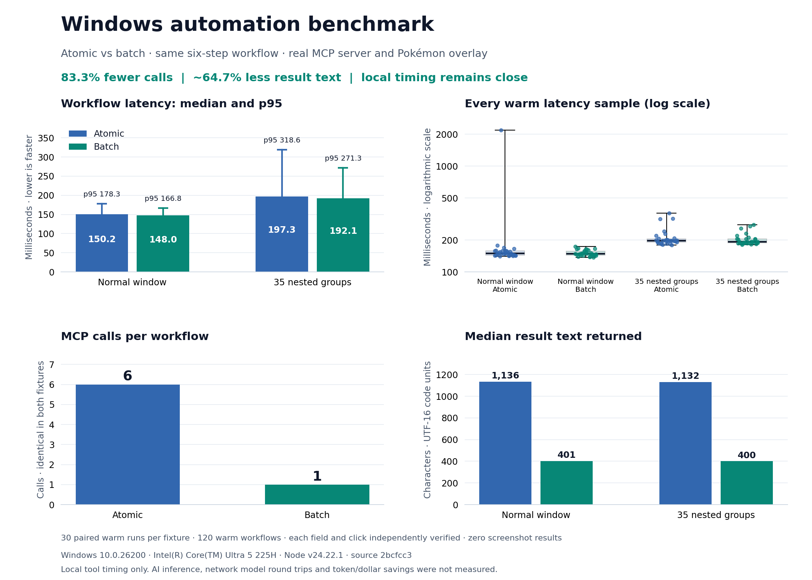

# Windows automation: benchmark with visuals



Batch reduces calls from **6 to 1 (83.3%)** and returned text by about **64.7%**. Local median execution is close: batch was **1.5%** faster in the normal fixture and **2.6%** in the nested fixture. These small timing differences do not establish a general execution-speed improvement. Nested controls were reachable and every workflow passed verification.

| Fixture | Atomic median | Batch median | Atomic p95 | Batch p95 | Median result text characters |
| --- | ---: | ---: | ---: | ---: | ---: |
| Normal window | 150.2 ms | 148.0 ms | 178.3 ms | 166.8 ms | 1136 → 401 |
| 35 nested groups | 197.3 ms | 192.1 ms | 318.6 ms | 271.3 ms | 1132 → 400 |

## Method and evidence

- **30 warm runs per mode per fixture**, paired with alternating atomic/batch order. 120 warm workflows; 124 recorded workflows including four first-in-session observations. Four additional verified warmups are excluded from the raw records and statistics: **128 successful workflows executed** in total.
- Real Windows UI Automation, MCP stdio transport and enabled Pokémon overlay. One disposable Electron fixture at a time: a normal field/button or the same controls inside 35 anonymous ARIA groups.
- Same six operations and 2,000-character per-step budgets: discover window, discover field, set a unique Unicode value, discover button, invoke once, read the field. Batch additionally checks the expected field value internally. Fixture state is independently checked over local HTTP after each workflow, outside the timer.
- Median averages the two middle values. p95 uses nearest rank. Charts include every warm latency sample and full-range whiskers; no sample or outlier is removed. The renderer recalculates statistics from the raw data and rejects mismatches.
- Timers exclude fixture/overlay launch, connection setup and independent HTTP verification. First-in-session readings are single observations with eager worker startup; they are not cold-start measurements. A compiled native worker DLL was used.
- No AI inference or network model round trips were measured. Characters are UTF-16 code units, not token counts. JSON/UTF-8 measurements exclude JSON-RPC envelopes, schemas and initialization. This fixture benchmark does not establish arbitrary-app, macOS/Linux or end-to-end AI performance.
- Electron emitted disk-cache permission diagnostics during companion startup; the overlay connected and every workflow verified successfully. Startup is outside the warm timers. No run was filtered because of its latency.

## Reproduce

Runtime source plus benchmark harness: `2bcfcc3e61bcf9f170044e296e09679dcfc948fb`; parent implementation is merged PR #4. Raw records include SHA-256 hashes of the executed backend, compiled worker and fixture/harness files. Environment: Windows `10.0.26200`, `Intel(R) Core(TM) Ultra 5 225H` (14 logical processors), Node `v24.22.1`, Electron `42.3.3`.

Build the backend/frontend first. This machine required `PSExecutionPolicyPreference=RemoteSigned` inherited only by the build/benchmark processes; no system policy or runtime source was changed.

```powershell
$env:PSExecutionPolicyPreference = 'RemoteSigned'
npm run benchmark:windows -- --runs 30 --fixture plain --output benchmarks/results/windows-main-2026-11-09-plain.json
npm run benchmark:windows -- --runs 30 --fixture nested --output benchmarks/results/windows-main-2026-11-09-nested.json
```

To regenerate the visual, install `matplotlib==3.10.8` in your plotting environment and run:

```text
python scripts/render-windows-benchmark.py benchmarks/results/windows-main-2026-11-09-plain.json benchmarks/results/windows-main-2026-11-09-nested.json --output benchmarks/results/windows-main-2026-11-09-visual.png
```

[Normal raw samples](windows-main-2026-11-09-plain.json) · [Normal full report](windows-main-2026-11-09-plain.md) · [Nested raw samples](windows-main-2026-11-09-nested.json) · [Nested full report](windows-main-2026-11-09-nested.md) · [Vector chart](windows-main-2026-11-09-visual.svg)
