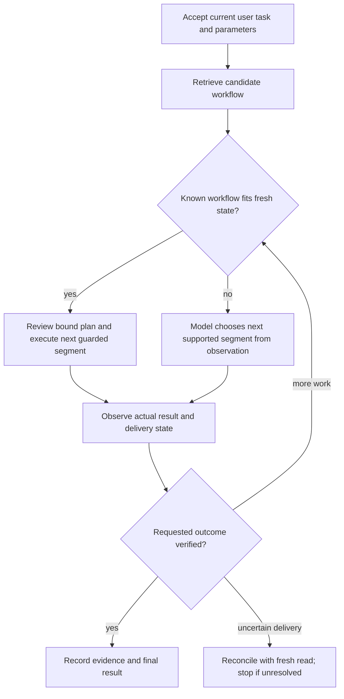

# Pokémon brain: research and design comparison

Research requested November 13, 2026, with delivery targeted for 9:00 PM Asia/Saigon. The user selected **research and compare designs**. This document records findings and proposed architecture; no new agent implementation or model deployment is included.

Status: research comparison and proposed evaluation plan completed. Implementation and live model benchmarking are future work under a separate scope. The 9:00 PM time is treated as a delivery deadline unless the user requests research to continue until then.

## Recommendation

A built-in controller can reduce external-client continuations, but installing a local language model does not automatically make execution faster. The most promising design is a **hybrid controller**: reuse verified workflows for known tasks and call a tool-capable model when current observations require a new decision. Keep the native MCP executor and its existing verification and pause behavior.

OpenAI's [latency guide](https://developers.openai.com/api/docs/guides/latency-optimization) identifies several levers, including fewer model requests, shorter generated output, suitable model size, independent parallel work, and classical code for constrained operations. Anthropic's [effective-agent guide](https://www.anthropic.com/research/building-effective-agents) distinguishes predefined workflows from dynamic agents and explains that additional agent complexity can trade latency and cost for task performance. Neither source establishes a speedup for this repository.

## What already exists in this checkout

Inspected Git revision `3ff5bfb3ef29f13d62ec030764ded6feae548c18` in the active `.publish` checkout. [Catalog evidence](../benchmarks/results/pokemon-brain-catalog-2026-11-13.json) includes source and built-file hashes.

| Component | Current evidence | Design implication |
| --- | --- | --- |
| External MCP control | README describes Claude/Codex/other MCP clients as the planner | Keep this supported route; a built-in brain would be another client of the executor |
| Built-in tool-loop code | `frontend/src/main/companion/agent.ts` calls Ollama `/api/chat`, executes returned tools, supplies actual results, and bounds the loop at 32 model rounds | A substantial controller prototype already exists |
| Shipping Talk surface | `frontend/src/main/companion/index.ts` returns “Talk is currently disabled”; renderer Talk button is hidden/disabled and Talk navigation redirects to actions | The existing code is not an enabled standalone agent in the shipped companion |
| Provider selection | `CompanionChat.reply` invokes the desktop tool loop only for `ollama`; other provider branches call conversational `streamChat` | Selecting a cloud provider currently does not enable that provider for native tool planning |
| Native action/observation bridge | `backend/src/talk/tools.ts` invokes original MCP handlers and automatically observes many inputs | Preserve this useful mechanism, while checking whether the model unnecessarily requests another read |
| Advertised Windows schema | Catalog lists atomic actions, with no `batch` action or `steps` property; agent instructions say one Windows action at a time | Model-facing support for known action-plus-observation segments is a specific next design opportunity |
| Workflow learning | CPU-only hashed-feature/logistic ranker and guarded recipes already exist in `backend/src/learning` | Reuse as task retrieval and workflow execution; it is not a general language planner |
| Built-in tool exposure | Browser catalog has desktop, windows, computer, human_handoff and task_done; course adds a course tool; learning/research are not registered by TalkTools | Existing backend capabilities are not all available to the built-in controller |
| Completion predicate | `task_done` re-reads named UI evidence and rejects a bare Edit/ComboBox result | A general agent still needs task-specific predicates, including exact retrieved facts and persisted save results |

The catalog experiment generated a 5,505-byte browser tool catalog and an 11,635-byte course catalog. Agent instructions add 4,288 UTF-8 bytes. These are serialized byte counts, not token or inference measurements.

The built-in Excel catalog fails before a model is invoked: `Transforms cannot be represented in JSON Schema`. `TalkTools.list` converts the refined Excel schema with the default `z.toJSONSchema`; the Excel range field contains a transform. This concerns the built-in adapter. The external MCP Edge/Excel suite previously passed 100/100 measured attempts and does not prove this separate adapter works.

Read-only/mocked validation: `node --test scripts/agent.test.cjs scripts/talk-tools.test.cjs` passed all 13 tests. Their model responses are local fixtures; this does not measure actual model quality or inference. The catalog failure shows a missing test case. Source behavior was inspected and preserved.

## Hardware and model context

The current Windows machine reports six logical processors, 16,994,697,216 bytes of physical RAM (about 15.8 GiB), and Intel UHD Graphics 630. The adapter's reported memory is not proof of dedicated usable model VRAM. The source default is `qwen3:8b` at `localhost:11434`; this is a default file, not confirmation of the user's active model or its runtime speed.

The agent requests a context size of at least 16,384 and an output cap of at least 1,024, while the source settings specify 4,096 and 512. It disables thinking output and awaits a non-streamed complete model response. A maximum output cap does not mean every response generates that many tokens, and requested context is not a measurement of allocated memory. This identifies settings to measure, not proof that reducing them is safe for all tasks. Context limits must cover the actual tool schema and recent observations.

Ollama's [tool-calling guide](https://docs.ollama.com/capabilities/tool-calling) documents model-selected tool loops and multiple tool calls. Its [chat API](https://docs.ollama.com/api/chat) documents keep-alive controls and response metrics such as model loading, prompt evaluation and generation duration/counts. Capture those metrics before deciding whether the local model, loading, or controller is slow. The [hardware guide](https://docs.ollama.com/gpu) includes Vulkan support; exact Intel-device support, drivers and speed on this machine remain unverified.

## Designs to compare

| Design | Expected advantage | Main cost or limitation | Current fit |
| --- | --- | --- | --- |
| Existing external MCP client | Mature model planner and client ecosystem | Per-decision client/model waits; controlled by the host client | Already supported |
| Built-in local model loop | Direct task UI and local model execution; fewer host handoffs | CPU/RAM/accelerator limits; still needs model inference for decisions | Prototype code exists, Talk deferred |
| Built-in remote model loop | Can use a capable tool model without fitting it on this PC | API/network latency, provider cost and data handling; provider tool adapters required | Current cloud-provider path is conversational only |
| Hybrid model plus workflow controller | Avoid model requests for known verified transitions; use existing learning, native APIs and batch executor | Requires accurate routing, explicit current parameters and fresh-state verification | Leading recommendation after agent-interface readiness fixes |
| Specialist visual GUI agent | Can address inaccessible visual/canvas controls | Screenshot processing, grounding models and extra decisions; native controls may be cheaper where available | Optional fallback after native/app-specific routes |
| Agent S4-style interface evolution | Discovers reusable operations and usage knowledge from task experience | Offline construction/evaluation cost, executable-code review, selection variance and broad execution privileges | Borrow interface-design ideas; defer autonomous evolution |

LangGraph's [workflows and agents guide](https://docs.langchain.com/oss/python/langgraph/workflows-agents) provides explicit routing, predetermined/dynamic paths, persistence and streaming patterns. A framework supplies orchestration utilities; it does not itself supply a model or establish lower latency than the repository's existing JavaScript controller.

Its current [persistence documentation](https://docs.langchain.com/oss/python/langgraph/persistence), reached through the former durable-execution URL, distinguishes thread-state checkpointers from longer-term application stores. This is useful for separating a task's resumable execution state from the workflow knowledge library. A checkpoint alone cannot prove whether an OS input was delivered before a crash; existing native delivery evidence and fresh-state reconciliation remain necessary.

OpenAI's [function-calling guide](https://developers.openai.com/api/docs/guides/function-calling?api-mode=responses) also recommends combining functions that always execute in sequence and limiting or deferring the tool surface. This supports a guarded action-plus-observation function for an already selected input. Strict JSON arguments still require runtime target, identity, capability and authorization checks. Multiple functions returned together are not a reason to execute dependent desktop inputs concurrently.

## Specialist interfaces: Agent S4

The current [Agent S repository](https://github.com/simular-ai/Agent-S) points to [Evolving Agent Interfaces](https://arxiv.org/abs/2610.28601), submitted October 20, 2026. Agent S4 evolves tool interfaces and usage knowledge from task trajectories, then selects interface repositories using held-out validation tasks. It reports 21.3% binary success on OSWorld V2 with Qwen3.8-27B and evolved interfaces, 3.8 times the same model with fixed interfaces. This is a reported task-success improvement, not a measured 3.8-times latency improvement. The older Agent S3 72.6% OSWorld result concerns another benchmark setup and must not be compared directly with OSWorld V2.

The [paper's methods and results](https://arxiv.org/html/2610.28601v1), sections 3–4 and 7.3, add material limits. The 108-task OSWorld aggregate includes the 15 official tasks used for repository selection; it is not a wholly untouched test set. Each interface-construction step has a two-hour wall-clock budget on OSWorld, and final task evaluation has a 300-response limit but no per-task wall-clock limit. Reported task-solving cost assumes an 80% input-cache hit rate and excludes repository construction and infrastructure. Its ScienceBoard evolved-versus-seed comparison is 58.58% versus 55.03%, with mean model calls declining from 61.7 to 58.9; the larger 41.4% baseline is a different fixed-interface agent. The paper also demonstrates substantial repeated-validation variance. These qualifications prevent importing its headline numbers as an expected local speed, cost, or reliability gain.

The transferable idea is to improve the model's available operations and know when to use them: a rectangular Excel range API can replace many cell-level actions; a passage finder can replace full-page transfer; a verified form operation can replace repeated planning around individual fields. This repo already demonstrates those mechanisms. Automatically evolving arbitrary executable interfaces is a separate research direction, with training/validation cost and execution controls beyond the bounded recipe system. It is not the recommended first implementation for this PC.

## Visual-agent reference and maintenance status

The official [UI-TARS Desktop repository](https://github.com/bytedance/UI-TARS-desktop) describes a vision-language agent using screenshots and mouse/keyboard actions, and an Agent TARS stack with MCP integration and GUI/DOM/hybrid browser strategies. The current GitHub page states that the owner archived the repository on **November 9, 2026**. Its README still contains historical remote-operator announcements; those announcements do not establish current service availability or fully local inference for every provider configuration.

Use this as an architectural reference for a future visual fallback, not as the first new runtime dependency. Pokémon's current built-in model-facing keyboard surface has no screenshot/coordinate tools, so adding a visual model also requires observation capture, grounding, coordinate transforms and fresh-target checks. A screenshot model alone does not add those components. Native text and bounded Excel/course/research operations already address much of the measured workload without visual grounding.

## Existing speed evidence and its limits

The [November 12 active-client experiment](../benchmarks/results/tool-selection-2026-11-12.md) observed four short workflows: combining an already chosen action with its observation reduced workflow calls from four to two and mean measured execution windows from 34.652 to 10.098 seconds. This is a small, coupled client/CLI experiment on another recorded machine; its gaps include model/client/rendering/transport work. It is not an isolated model-speed comparison or a causal result for a new brain.

The [current local assessment](repository-strength.md) found 84/84 verified native workflows and 100/100 common-operation attempts passed, with plain/deep-tree execution times close between atomic and batched strategies. That supports optimizing orchestration and model-request count while measuring native work separately.

The [ranker evaluation](local-ranker-improvements.md) measures sub-millisecond task retrieval and rejects 80 tested incorrect-reuse cases, but leaves eight unlearned semantic paraphrases unsupported. Improving that ranker alone cannot remove seconds of model/client waiting, and its synthetic correctness is not a general task-success rate.

## Recommended controller boundary

Build the smallest hybrid controller around the existing TypeScript executor. Keep model-provider choice replaceable. A larger orchestration framework is optional when graph composition, checkpoints or distributed execution justify its integration cost; installing one is not a performance optimization by itself.

The workflow ranker should retrieve candidates, not supply permission or decide whether a desktop input is safe. Bind the current task's named parameters, inspect current app identity, preview the concrete plan and use the guarded executor. On a low-confidence match, changed precondition or unseen branch, return to fresh observation and model planning. The model can choose the next known segment; it cannot pre-authorize a future branch whose result is still unknown.

Keep deterministic code responsible for schema validation, fresh control identity, supported actions, input exclusion, cancellation, deadlines, output bounds, delivery classification and evidence collection. The model handles semantic intent, interpreting unfamiliar states and selecting supported operations. For known tasks, use task-specific verifiers: exact field readback, selected result identity, quoted fact with source, or workbook contents and exact saved path after reopen. A visible non-edit control with a matching name is insufficient evidence for all of those outcomes.

Separate three kinds of state: a task journal with current parameters and execution evidence; ephemeral UI references that must be rediscovered; and reusable workflow knowledge. Record observed task outcome separately from user satisfaction. A model or successful tool return must not fabricate positive feedback for the ranker.

### Interruption and uncertain delivery

The existing [PR workflow controller](workflow-controller.md) already journals before dispatch and reconciles uncertain mutations by reading the remote state. Apply that principle to the desktop controller, with a per-task exclusive owner and immutable task/target identity:

| State at interruption | Resume behavior |
| --- | --- |
| Input not dispatched | Re-discover and validate preconditions before considering dispatch |
| Input dispatched, no reliable acknowledgement | Mark delivery unknown; read current app state and retain the original dispatch record |
| Input acknowledged, result observation failed | Repeat a bounded read; do not repeat the input |
| Result independently verified and recorded | Return the saved result; no further input |
| State cannot resolve whether the input happened | Stop that mutation and request an explicit human decision |

Persist a dispatch identifier, task parameters, action, timestamps, tool disposition, and bounded outcome evidence. Do not replay stored element IDs after a restart. Use persistent storage for a resumable journal: LangGraph's in-memory checkpointer example loses checkpoints across process restarts, as its current persistence guide explains. A persistent checkpoint still cannot atomically commit both disk state and arbitrary UI input. Where an application has a supported idempotency key or transaction API, use it; do not assume Windows clicks have that property. Cancellation during dispatch may leave delivery unknown even though later steps stop.

## Readiness priorities before a prototype benchmark

These are proposals, not changes made in this research task.

1. Resolve and cover the Excel catalog serialization failure. Verify every advertised tool schema and optional-tool route can initialize without invoking a model.
2. Restore a deliberate Talk entry point and task lifecycle, with visible pause, unfinished and handoff states. Include the existing agent/adapter tests in normal CI; add coverage for the missing catalog and task-specific completion cases.
3. Introduce a provider adapter for tool calls and results. Preserve actual results and provider-native call IDs where required. Current conversational cloud streams cannot substitute for this adapter.
4. Expose a small set of guarded action-plus-observation segments, range operations and targeted research/workflow tools. Preserve native guards while avoiding unnecessary read-only model turns. Test long text with full readback, not clipped preview matching.
5. Record model loading, prompt processing, generation, request durations/counts, tool/native time and unclassified client gaps. Configure context/output budgets from observed workload needs, and measure cold and warm sessions.
6. Add durable state and task-specific verifiers, then compare local/remote/hybrid planners on the same task corpus. Add screenshot grounding only for a demonstrated native-access gap.

Current dependency audit findings in [repository-strength.md](repository-strength.md) remain a separate release-readiness concern. An agent architecture does not resolve those findings.

## Controlled evaluation plan

No live inference, paid model call or new controller was run for this comparison. Use the following plan before claiming a brain makes Pokémon faster.

### Experiments and controls

| Experiment | Hold fixed | Change | What the result can establish |
| --- | --- | --- | --- |
| Controller placement | Exact model endpoint/version, settings, prompt, tool catalog, executor and initial state | External adapter versus built-in adapter | Adapter/client overhead under those controls |
| Decision granularity | Same model/provider, controller, guards, tasks and budgets | Atomic planning versus guarded known segments | Effect of fewer decisions and different tool granularity |
| Workflow reuse | Same model and native executor | Hybrid retrieval/verified replay versus model-only loop | Known-task gains, routing errors and unseen-task fallback cost |
| Inference location | Same weights, quantization, tokenizer, settings and semantic task interface where feasible | Local versus remote serving | Serving/hardware/network effect for that configuration |
| Model capability | Same controller, tasks and allowed observations/actions | Model size or provider | Quality/latency/cost tradeoff, with model differences explicit |

An external Codex run and a local Qwen run cannot isolate controller placement because both planner and client differ. If a host does not expose equivalent settings or timing, mark the comparison confounded. Run controlled external-adapter experiments separately from descriptive real-client traces. Test one change at a time before a combined optimized arm.

Pin source commit, built-file hashes, actual runtime model digest, prompt/catalog, app versions, locale, screen scaling, benchmark fixtures and allowed actions. Capture model context/output options and warm-state evidence. Clear or freeze learned workflows according to the experiment; never allow the evaluated controller to inspect answer keys. Reset fixture state between attempts, run desktop input serially, counterbalance arm order and keep unrelated foreground activity out of the run. Independent tasks may run concurrently only in separate isolated environments.

### Proposed local task set

Start with **24 independently specified tasks**, six in each group below, and three reset attempts per arm. That produces 72 task attempts per arm; it is a pilot design, not completed evidence. Keep the holdout instructions, expected results and verifiers separate from development fixtures. Three attempts expose some variance but do not establish a reliable tail-latency estimate.

| Task group | Representative cases | Required outcome evidence |
| --- | --- | --- |
| Known workflows | Browser passage lookup, exact form fill, rectangular Excel read/calculation/save | Correct fact and source, full text, calculated values and reopened saved file |
| Unseen semantics/branches | English/Vietnamese paraphrase, search with multiple candidates, delayed result, app choice requiring inspection | Correct target/branch and all requested results; no guessing from ranker match |
| Recovery | Minimized app, stale reference, cancelled wait, worker interruption before/after input, observation timeout | Fresh identity, no duplicate input, correct delivery classification and resumable state |
| Ambiguity and scope | Same-named targets, clipped/truncated tree, unsupported control, page text requesting an unrelated action | Correct stop or clarification and no unauthorized input; handoff recorded separately from completed task |

Define task-level deadlines and decision/action limits before running. Use disposable local pages and workbooks for mutations. Inject failures only in owned fixture components. Preserve every timeout, blocked case, wrong fact, wrong-target action and recovery attempt. A correct clarification is a scope-handling result, not a successfully completed desktop task.

### Measurements and acceptance

Measure natural-language intake to **independently verified requested result** and to durable recording. Also measure time to the first relevant observation or useful verified effect; a pet animation or first model token is not that effect. Log model requests, input/output tokens, loading/prompt/generation durations, native action/wait time, verification time, warm/cold status and restart gaps. Union overlapping spans; keep unexplained host/network/scheduling gaps unclassified. A streamed partial tool argument must be complete and validated before execution.

Report passed/attempted counts by task family, wrong-target/unauthorized/duplicate-input events, incomplete/blocked/timeouts, end-to-end median and empirical tail samples, plus API or serving cost where measured. Present successful-run latency beside all-attempt outcomes; never drop failures to make the fast arm look better. Distinguish cold model load from cold MCP/worker startup, and state exactly what each timing boundary excludes.

Use paired task results and uncertainty intervals. Repeated trials of the same task are correlated, so analyze or resample at task level rather than treating every attempt as independent. A 24-task pilot cannot prove broad model reliability. Treat wrong-target actions, replay after unknown delivery, ignored cancellation or false completion as release blockers in this fixture suite. Prefer the faster design only when its independently verified outcomes support that choice; if quality changes, present the tradeoff instead of declaring an unconditional speedup.

## Public benchmark path

[Windows Agent Arena](https://github.com/microsoft/WindowsAgentArena), reviewed in the prior repository assessment, remains the closer native-Windows target. Public task evaluation requires a complete planner/action adapter and independent evaluator, rather than just an MCP server.

The current official [OSWorld V2 repository](https://github.com/xlang-ai/OSWorld-V2) recommends **osworld-v2.1**, released September 16, 2026. Its documentation requires matching code, task classes, assets, mocked websites and VM images from the same release. Task classes and complete assets are gated; the recommended website version is self-hosted. Docker/Linux and AWS images are provided, and the guest is Ubuntu. That is substantial environment/adapter work and does not directly measure this PC's Windows UIA executor. Do not label a local fixture result an OSWorld score, or compare a new 2.1 run to paper results without confirming their exact release and execution conditions.

For a later public run, pin the release manifest and evaluator, separate controller-development tasks from final evaluation, publish failed/blocked counts and trajectories, and report supported surfaces. Any infrastructure spend, credentials or gated dataset enrollment would be a separate setup task. None was performed here.

## Evidence and open questions

Primary-source pages were read in the existing Edge profile through Pokémon MCP. The dense Agent S4 HTML paper exceeded native discovery's 2,500-node scan bound, so methods/results were read through a certificate-verified, read-only PowerShell HTTPS fetch and text extraction from the observed public URL. The first Python fetch failed local certificate validation; no verification bypass was used. Accessible excerpt search is not proof of complete source coverage. The versioned UI-TARS, LangGraph persistence and two-page OSWorld readings were complete within the tool's text bound. See [source-reading metadata](../benchmarks/results/pokemon-brain-sources-2026-11-13.json).

Still unmeasured: active Ollama model/runtime, actual acceleration on this Intel GPU, cold/warm inference time, local-versus-remote serving, live model task success, and hybrid routing reliability. The research recommendation is therefore **repair the existing agent interface, instrument it, then compare a hybrid controller against a model-only baseline**. It is not a demonstrated speedup and does not require deploying a new large model first.
